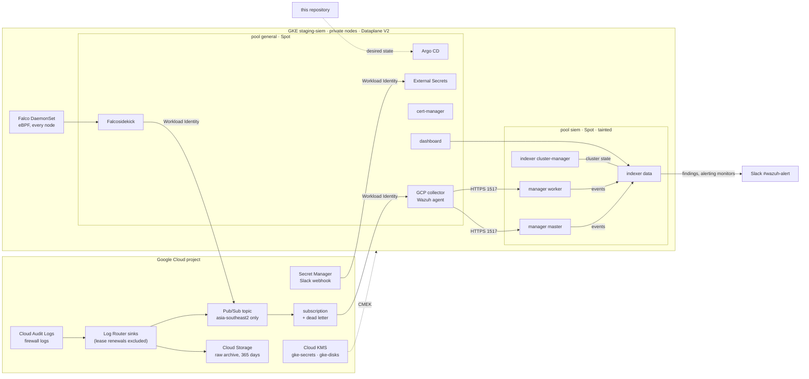

# wazuh-siem-gitops

A **Wazuh 5** SIEM on GKE for the audit and security logs of a Google Cloud project. Everything is
declared in this repository: **Terraform** builds the Google Cloud side, **Argo CD** reconciles every object
in the cluster, including the Wazuh configuration, certificates, credentials, detection content and alert
monitors. No service account key exists anywhere: Google Cloud access goes through **GKE Workload Identity**.

## Highlights

- **Keyless.** The Wazuh GCP collector pulls Pub/Sub with Workload Identity; External Secrets reads
  Secret Manager the same way. No JSON key is created, stored or mounted.
- **Fully GitOps.** Wazuh configuration, PKI, generated passwords, agent enrollment, ruleset activation,
  Slack channel and alert monitors are all reconciled from Git; nothing is clicked in the dashboard.
- **Scale-out.** Dedicated indexer cluster-manager and data nodes, a manager master with workers, and node
  certificates with wildcard SANs, so adding replicas needs no new certificate.
- **Encrypted with Cloud KMS.** Kubernetes Secrets in etcd, node boot disks and every persistent volume.
- **Alerts from Wazuh only**, to Slack, colored by level, plus alerts on the health of the SIEM itself.

## Topology



| Component | Replicas | Placement | Storage |
|---|---|---|---|
| Indexer cluster-manager | 1, scale out to 3 by `replicas` and `discovery.seed_hosts` | pool `siem` | 5 Gi `pd-balanced-cmek` |
| Indexer data (+ ingest) | 1, scale out by `replicas` | pool `siem` | 50 Gi `pd-balanced-cmek` |
| Manager master / worker | 1 / 1, scale out workers by `replicas` | pool `siem` | 10 Gi `pd-balanced-cmek` |
| Dashboard | 1, stateless | pool `general` | — |
| GCP collector | 1 | pool `general` | 1 Gi `pd-standard-cmek`, agent identity |
| Falco / Falcosidekick | 1 per node / 1 | every node / pool `general` | — |

Shards have no replica: the single data node keeps every shard on its persistent disk, so a Spot preemption stops the indexer until the pod is rescheduled, and no data is lost. With more data nodes, raising `cluster.default_number_of_replicas` in [`indexer.yaml`](infrastructure/configs/wazuh/base/indexer.yaml) gives new indices a replica on another node.

## Keyless Google Cloud access

The Wazuh `gcloud` wodle only builds its Pub/Sub client from a service account key file. The collector image
([`images/wazuh-gcp-collector`](images/wazuh-gcp-collector)) adds Python 3.12 with the client libraries
Wazuh pins, and [`patch_wodle.py`](images/wazuh-gcp-collector/patch_wodle.py) changes two things in it:

- the client uses **Application Default Credentials** unless the credentials file is a service account key,
  so the GKE metadata server provides the identity;
- each pull run stops after 30 seconds, so a steady trickle of logs never keeps a run past the one-minute
  interval.

The patch matches the upstream code exactly; if a Wazuh upgrade changes it, the image build fails instead of
shipping an unpatched wodle. On the Google Cloud side, `roles/pubsub.subscriber` is granted on the
subscription only, to the Kubernetes ServiceAccount itself
(`principal://…/subject/ns/wazuh/sa/wazuh-gcp-collector`): there is no Google service account to leak a key
from. A NetworkPolicy opens the metadata server (`169.254.169.254`, ports 80 and 8080) to that Pod only.

## Wazuh on Kubernetes, the GitOps way

| Concern | Implementation |
|---|---|
| Certificates | cert-manager: deployment CA and one certificate per role, PKCS#8 keys, wildcard SANs for indexer nodes |
| Passwords and cluster key | External Secrets `Password` generators, `refreshPolicy: CreatedOnce` (Wazuh keeps its first passwords) |
| Manager configuration | `wazuh-manager.conf` in a hashed ConfigMap, copied over on every start; a change rolls the managers |
| `vm.max_map_count` | GKE node system config on the `siem` pool, so no privileged container |
| Agent enrollment | Argo CD Sync hook mints an enrollment token through the manager API into a Secret |
| GCP ruleset | Sync hook enables the `gcp` integration of the standard ruleset through the indexer content manager |
| Slack and monitors | Sync hook keeps the notification channel and the monitors in [`alerting/`](infrastructure/configs/wazuh/base/alerting) |
| Kubernetes detections and dashboard | Sync hook reconciles the rules, detector and dashboard in [`k8s-security/`](infrastructure/configs/wazuh/base/k8s-security) |
| Network | default-deny NetworkPolicies per component, including NodeLocal DNSCache |

## Alerts

| Monitor | Fires when | Slack color |
|---|---|---|
| Wazuh findings to Slack | a new finding of level high or critical | red, bright red |
| Wazuh indexer health | the indexer cluster is not green | orange |
| Wazuh indexer disk | a node disk is above 75% | orange |
| Wazuh GCP log pipeline stalled | no GCP event is indexed for 15 minutes | bright red |

A Google Cloud API call reaches Slack in about three minutes. Findings of level low and medium stay in the dashboard.

## Kubernetes security

GKE runs the Kubernetes API server, so its audit log is not a file on a node: GKE writes it to Cloud Audit
Logs, and the same sink that carries the Google Cloud audit logs brings the Admin Activity entries of
`k8s.io` (every write to the API) to Wazuh, decoded by the `gcp` integration.

[`k8s-security/gke-kubernetes.json`](infrastructure/configs/wazuh/base/k8s-security/gke-kubernetes.json) holds Sigma rules on
those events. A Sync hook writes them to a user-managed `gke-kubernetes` integration of the content manager,
promotes them draft → test → custom and points a Ruleset Management detector of the same name at
`wazuh-events-v5-cloud-services`; a rule removed from the file is deleted. Every rule except the anonymous
one ignores the API server, the GKE system components, the cluster controllers, Argo CD, cert-manager,
External Secrets and the enrollment hook, so what reaches Slack is a person or a workload acting on the API:

| Rule | Level |
|---|---|
| Exec or attach into a pod | high |
| Exec or attach into a pod of `kube-system`, `wazuh`, `argocd`, `cert-manager` or `external-secrets` | critical |
| Ephemeral container added to a pod (`kubectl debug`) | high |
| Port-forward to a pod | medium |
| Pod or workload controller created outside GitOps | high |
| Pod or workload controller created in `kube-system` | critical |
| Pod or workload controller patched or updated outside GitOps | high |
| Secret created, changed or deleted outside GitOps | high |
| `kube-system` ConfigMap created, changed or deleted | high |
| NetworkPolicy created, changed or deleted outside GitOps | high |
| Namespace changed or deleted outside GitOps | high |
| PersistentVolumeClaim or PersistentVolume deleted | high |
| Workload, Service, ServiceAccount or ConfigMap deleted in a system or security namespace | high |
| Service, Ingress or Gateway API route created or changed outside GitOps | high |
| Role or ClusterRole created or changed | high |
| RoleBinding or ClusterRoleBinding created or changed | high |
| Service account created in `kube-system` | high |
| Write denied to a workload service account (a pod probing its permissions) | high |
| Write denied to a user | medium |
| Write from curl, wget, a Python HTTP library or a Kubernetes attack tool | high |
| Certificate signing request created | high |
| Certificate signing request approved | critical |
| Admission webhook created, changed or deleted | high |
| APIService (aggregated API) created or changed | critical |
| CustomResourceDefinition created, changed or deleted outside GitOps | high |
| Write accepted from an anonymous user | critical |

Admin Activity has no reads and no TokenRequests, and the request body stays in the unindexed
`event.original`, so listing secrets, `nodes/proxy`, service account tokens and privileged or `hostPath`
pods are not detected; a pod created outside GitOps is, whatever its spec. A stolen service account
token cannot be replayed from outside: the DNS endpoint accepts Google IAM credentials only and the IP
endpoint only the node subnet.

The same hook writes the **GKE Kubernetes security** dashboard: findings by level, rule and time, the
actions of people and workloads by principal and source IP, exec sessions, RBAC changes, secret, service
account and certificate operations, and write trends by method and namespace.

## Runtime security (Falco)

Audit logs only show calls to the API. What runs inside a container (a shell, a dropped binary, a read of
`/etc/shadow`, a reverse shell) is seen by Falco, a DaemonSet on every node, including the tainted `siem`
pool. It uses the modern eBPF probe in least-privileged mode: the capabilities `BPF`, `PERFMON`,
`SYS_RESOURCE` and `SYS_PTRACE` instead of a privileged container, which is why the `falco` namespace
enforces the `privileged` Pod Security level.

Falco sends its alerts to Falcosidekick, which publishes them to the same Pub/Sub topic as the audit logs
with Workload Identity (`roles/pubsub.publisher` on the topic for `falco/falco-falcosidekick`, no key);
the GCP collector brings them to Wazuh with the rest. Falco adds `wazuh_*` fields to each alert (namespace,
pod, container, image, process, command line, user, file), so no node runs a Wazuh agent.

[`k8s-security/falco.json`](infrastructure/configs/wazuh/base/k8s-security/falco.json) is the second
content pack of the same Sync hook. Its root decoder becomes the root of the custom space policy and lets
through only the messages that carry `wazuh_integration: falco`; the `falco` decoder maps them to the
Wazuh Common Schema (`rule.name`, `log.level`, `process.*`, `container.*`, `orchestrator.*`, `file.path`)
into `wazuh-events-v5-security`, and a `falco` detector turns them into findings by Falco priority:

| Falco priority | Finding level |
|---|---|
| Emergency, Alert, Critical | critical |
| Error, Warning | high |
| Notice | medium |

The Slack message of a Falco finding carries the Falco rule, the process and user, the container and
image, the namespace and pod, and the Falco output. The standard `gcp` decoder also keeps a generic copy
of each alert in `wazuh-events-v5-cloud-services`, without findings.

## Repository layout

```text
terraform/        # Google Cloud: APIs, KMS, VPC, NAT, GKE, Artifact Registry, archive bucket, Pub/Sub,
                  # log sinks, Data Access audit logs, Secret Manager, Argo CD bootstrap (see terraform/README.md)
bootstrap/        # root Application applied by Terraform
appsets/          # AppProject and the controllers and configs ApplicationSets
infrastructure/
  controllers/    # Helm charts: cert-manager, external-secrets, falco
  configs/        # Kustomize: namespaces, secret store, CMEK StorageClasses, wazuh
images/           # GCP collector image, built and pushed with make -C images release
```

Values that contain the project ID (registry, subscription, KMS key) never enter Git: Terraform writes them
as annotations of the Argo CD cluster secret and the ApplicationSets inject them.

## Deploy

```bash
cp .env.example .env                   # PROJECT_ID and GITOPS_REPO_URL
make -C terraform apply-all            # Google Cloud, GKE, Argo CD, then waits for every Application
make -C images release                 # collector image to Artifact Registry
read -rs URL && printf '%s' "$URL" | gcloud secrets versions add staging-siem-slack-webhook --data-file=-

kubectl -n wazuh port-forward svc/wazuh-dashboard 8443:443   # https://localhost:8443, user admin
kubectl -n wazuh get secret wazuh-credentials -o jsonpath='{.data.indexer\.env}' | base64 -d | grep ADMIN
```

## Versions

Wazuh **5.0.0-rc2**, the latest 5.x release, pinned in
[`infrastructure/configs/wazuh/base/kustomization.yaml`](infrastructure/configs/wazuh/base/kustomization.yaml)
and in the collector `Dockerfile`; moving to 5.0.0 GA is a tag change in both. GKE 1.35, Argo CD 3.5,
cert-manager 1.21, External Secrets 2.15, Falco 0.45 (chart 9.2), Terraform 1.15.
